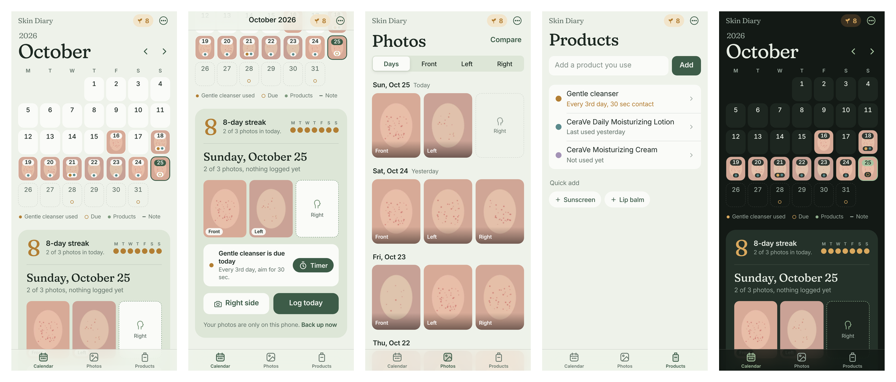

# Skin Diary

A private, offline-first iPhone app for tracking skin progress day by day: three photos a day, what you used, notes, and a schedule for slowly reintroducing a cleanser.

**Live app:** https://ongmikey05.github.io/skin-diary/ (open in Safari on iPhone, then Share → Add to Home Screen)



*Screenshots use generated placeholder images, not real photos.*

## Why I built it

I was repairing my skin barrier and wanted to reintroduce a cleanser gradually: every 4th day, then every 3rd, every 2nd and finally daily, while slowly increasing how long it stays on my skin. I wanted a tracker that supported that kind of schedule and kept my photos only on my phone, so I built my own.

## Features

- **Calendar:** every day shows a photo thumbnail and markers for products used, cleanser due days and notes.
- **3 photos a day:** front, left side and right side, taken with the front camera or picked from the library.
- **Photo timeline and compare:** browse all photos by day or by angle, and compare two days side by side.
- **Products and cleanser plan:** a daily product checklist; tracked products follow a schedule (every 4th, 3rd or 2nd day, or daily) with a contact-time goal and a built-in timer.
- **Streak counter:** consecutive days with at least one photo.
- **Private by design:** no accounts, no server and no analytics. Photos never leave the phone, and backup and restore uses a single file.
- **Works offline:** installs to the Home Screen and runs with no internet connection.

## How it works

| Area | Approach |
| --- | --- |
| Platform | Progressive Web App (PWA) built for iPhone: standalone display, safe-area insets, dark mode and haptics |
| Front end | Plain HTML, CSS and JavaScript, with no frameworks or dependencies |
| Storage | IndexedDB (days, products, metadata, full-size photos and thumbnails as blobs). Photos are resized on the device to 1600px, with 420px thumbnails |
| Offline | A service worker caches every file, cache-first, with a content-hash version, so updates install automatically |
| Backup | Exports to a single JSON file with photos embedded, saved through the iOS share sheet; restore reads it back |

## Project structure

```
index.html            the whole app: markup, styles and JavaScript
sw.js                 service worker (offline cache)
manifest.webmanifest  install settings for the Home Screen
icon-*.png, fraunces.woff2   app icons and font
```

## Run locally

```bash
python3 -m http.server 8000
```

Then open http://localhost:8000.

## Credits

Designed and product-managed by Mikey Ong. Built with AI assistance (Claude by Anthropic).
